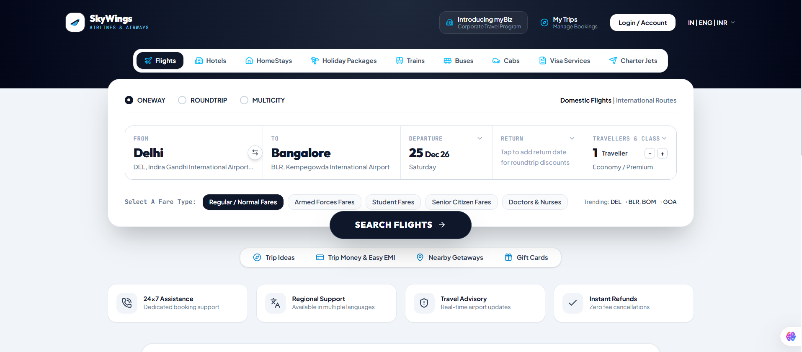
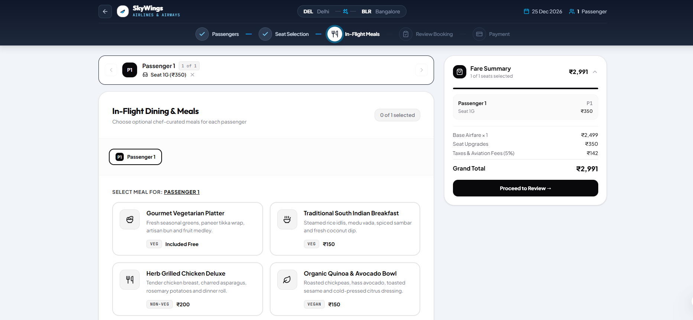
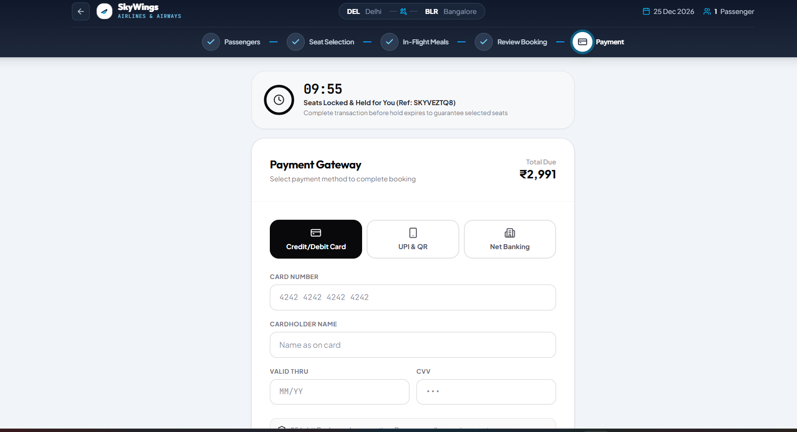
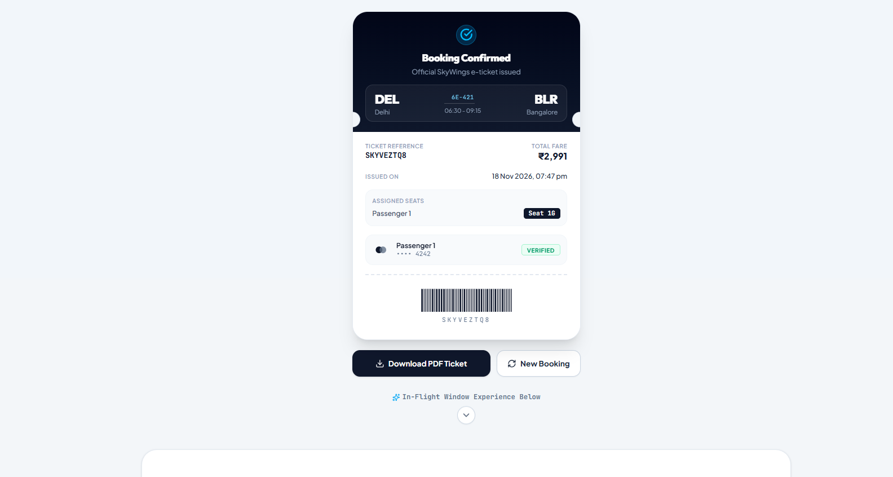

# SkyWings — Flight Seat Selection & Passenger Management System

[](https://react.dev/)
[](https://www.typescriptlang.org/)
[](https://vitejs.dev/)
[](https://tailwindcss.com/)
[](https://zustand-demo.pmnd.rs/)

> A production-grade, highly responsive, interactive airline booking experience built for the **Flight Seat Selection & Passenger Management Technical Assessment**. Features dynamic passenger scaling, BookMyShow-style interactive cabin layouts (3–2 and 2–3–2 configurations), an in-flight dining engine, real-time 10-minute seat lock simulation, downloadable boarding passes, and interactive 21st.dev cabin window views.

---

## 🔗 Project Links

- **Live Production URL:** [https://sykwings.vercel.app/](https://sykwings.vercel.app/) 
- **GitHub Repository:** [https://github.com/Arihant09x/Flight-Seating-booking-system](https://github.com/Arihant09x/Flight-Seating-booking-system) 
---

## 📸 Screenshots Showcase

### 1. MakeMyTrip-Style Flight Search Hero
> Complete segmented grid search box with interactive trip types, airport pickers, date controllers, fare categories, quick utilities, and special offers.


*Hero flight search with dynamic passenger selector, route swap, and floating action button.*

---

### 2. Interactive BookMyShow-Style Aircraft Seat Map
> Interactive aircraft cabin outline with cockpit header, row numbers, visible aisles, emergency exits, and real-time tooltips. Supports **3–2** (Airbus A320) and **2–3–2** (Boeing 767) layouts.


*Color-coded categories: Free Standard, Premium (+₹250), Extra Legroom (+₹350), Occupied, and Passenger Selections.*

---

### 3. In-Flight Dining & Gourmet Meal Selection
> Zero-emoji, icon-driven dining menu with dietary tags (Veg, Non-Veg, Vegan, Jain), descriptions, pricing, and individual traveller tabs.


*Gourmet dining options selectable individually for each active passenger.*

---

### 4. 10-Minute Seat Hold & Dummy Payment Gateway
> Real-time animated circular countdown timer holding seats for 10 minutes (matching BookMyShow/RedBus locking mechanics). Supports Card, UPI, and Net Banking.


*Real-time SVG countdown timer preventing double-booking and releasing seats on expiry.*

---

### 5. Official E-Ticket & 21st.dev Airplane Window Gallery
> Premium boarding pass with ticket cut-outs, dynamic barcodes, fare breakdown, confetti celebration, one-click PDF ticket download, and interactive cabin window shades.


*Screen-fitted official ticket card (`ravikatiyar162/ticket-confirmation-card`) and interactive cabin window gallery (`dhxwhy/airplane-window-gallery`).*

---

## 🚀 Key Features

### 💺 Core Seat Selection & Cabin Logic
- **Dual Aircraft Layouts:**
  - **Layout 1 (3–2):** Left seats (A, B, C) | Aisle | Right seats (D, E)
  - **Layout 2 (2–3–2):** Left seats (A, B) | Aisle | Middle seats (D, E, F) | Aisle | Right seats (G, H)
- **Zero Duplicate Assignments:** A passenger can hold only one seat; a seat belongs to strictly one passenger.
- **Occupied State Protection:** Occupied seats are disabled, cannot be selected, and retain visual indication.
- **Layout Switching Resilience:** Preserves seat assignments whose identifiers exist in both configurations.
- **Smart Filter & Recommendations:**
  - One-click filters: *Free (₹0)*, *Premium*, *Extra Legroom*, *Window*, *Aisle*.
  - Smart recommendations: *Cheapest*, *Window*, *Aisle*, *Extra Legroom* with explanations.
- **Undo & Reset Support:** Full undo history stack allowing users to revert recent seat changes.

### 👥 Dynamic Passenger Management
- Supports **1 to 5 passengers** with automatic state re-indexing.
- Real-time inline passenger name editing.
- Active passenger switcher bar with previous/next controls and current assignment summary.
- Automatic auto-advance to the next unassigned passenger upon seat selection.

### ⏱️ BookMyShow / Bus-Style 10-Minute Seat Hold
- When proceeding to checkout, an active **10-minute seat lock (`SeatLock`)** begins.
- Circular SVG progress ring with minute/second countdown.
- Warns users when under 2 minutes remain.
- Automatically releases held seats and redirects back if payment expires.

### 🍽️ Optional In-Flight Meal Selection
- Modular meal engine featuring Chef Platters, South Indian Breakfast, Herb Chicken, Vegan Bowls, and Jain Thalis.
- Categorized with dietary tags, pricing, and independent passenger assignments.

### 🧾 Booking Summary & Downloadable E-Ticket
- Sticky desktop sidebar & responsive summary updating dynamically as seats or meals are toggled.
- Currency formatted in Indian Rupees (`₹350`, `₹2,499`) using the `en-IN` locale.
- **Official 21st.dev Ticket Component (`ravikatiyar162/ticket-confirmation-card`)**:
  - Ticket notch cut-outs, dashed tear lines, verified card badge, and dynamic alphanumeric barcode.
- **Interactive 21st.dev Cabin Windows (`dhxwhy/airplane-window-gallery`)**:
  - Simulated oval airplane cabin windows with pull-down animated shades and full-bleed altitude scenery zoom.
- **One-Click Client-Side PDF Export**: Uses `jspdf` and `html2canvas` to render an official e-ticket boarding pass.

---

## 🛠️ Tech Stack & Architecture

| Technology | Purpose |
| :--- | :--- |
| **React 19** | Modern UI rendering and component architecture |
| **TypeScript (Strict)** | End-to-end type safety with zero `any` types |
| **Vite 6** | Ultra-fast development server and optimized build bundling |
| **Tailwind CSS v4** | Modern utility-first styling with custom theme definitions |
| **Zustand 5** | Predictable global state management with LocalStorage persistence |
| **Framer Motion 14** | Smooth layout animations, dialog transitions, and window shades |
| **Lucide React** | Clean, minimalist, scalable vector iconography (zero emojis) |
| **Radix UI** | Accessible, unstyled primitives (Tooltip, Popover, Dialog) |
| **Sonner** | Non-intrusive toast notifications for user interactions |
| **jsPDF & html2canvas** | High-fidelity client-side PDF boarding pass generation |

---

## 📁 Project Directory Structure

```text
Flight Seat Selection---Passenger Management/
├── index.html                           # HTML shell with Google Fonts & metadata
├── package.json                         # Project dependencies & build scripts
├── tsconfig.json                        # Monorepo TypeScript config
├── tsconfig.app.json                    # Application TypeScript compiler settings
├── vite.config.ts                       # Vite bundler configuration & path aliases
├── public/
│   └── favicon.svg                      # Custom SkyWings aerodynamic wing logo
└── src/
    ├── main.tsx                         # React 19 entry point
    ├── App.tsx                          # Root container with Sonner toaster
    ├── index.css                        # Tailwind v4 theme, fonts, custom scrollbars
    ├── types/
    │   └── booking.ts                   # Core TypeScript interfaces (Seat, Passenger, Flight, etc.)
    ├── data/
    │   ├── flights.ts                   # Flight schedule mock (DEL → BLR)
    │   ├── seats.ts                     # Cabin seat data for 3–2 and 2–3–2 configurations
    │   ├── meals.ts                     # In-flight dining catalogue
    │   └── passengers.ts                # Passenger model generator & palette
    ├── store/
    │   └── bookingStore.ts              # Global Zustand store with persistence & lock logic
    ├── utils/
    │   └── pricing.ts                   # Centralized calculation, locale formatting & validation
    ├── lib/
    │   └── utils.ts                     # Class variance and tailwind-merge helper
    ├── components/
    │   ├── ui/
    │   │   ├── BrandLogo.tsx            # Aerodynamic wing emblem & airline typography
    │   │   ├── TicketConfirmationCard.tsx# 21st.dev ravikatiyar162 ticket component
    │   │   └── AirplaneWindowGallery.tsx# 21st.dev dhxwhy interactive window gallery
    │   ├── layout/
    │   │   ├── SearchHero.tsx           # MakeMyTrip-style flight search hero section
    │   │   ├── AppHeader.tsx            # Executive airline header with route metadata
    │   │   └── ProgressStepper.tsx      # Single-level progress bar with natural slate tones
    │   ├── passengers/
    │   │   ├── PassengerSelector.tsx    # Passenger count & inline name editor
    │   │   └── ActivePassengerBanner.tsx# Active traveller switcher
    │   ├── seat-map/
    │   │   ├── AircraftSeatMap.tsx      # BookMyShow interactive cabin seat map
    │   │   ├── Seat.tsx                 # Individual seat button with popover tooltip
    │   │   ├── SeatRow.tsx              # Row container with aisle & exit door indicators
    │   │   ├── SeatLegend.tsx           # Visual color key and price categories
    │   │   └── AircraftShell.tsx        # Fuselage styling, cockpit nose & tail indicators
    │   ├── meals/
    │   │   └── MealSelection.tsx        # Dietary card grid & traveller meal assignment
    │   └── booking/
    │       ├── BookingSummary.tsx       # Sticky desktop & responsive fare ledger
    │       ├── BookingReview.tsx        # Itinerary review and invoice breakdown
    │       ├── PaymentPage.tsx          # 10-min countdown timer & dummy payment gateway
    │       └── ConfirmationPage.tsx     # Boarding pass display & PDF ticket download
    └── pages/
        └── FlightSeatSelectionPage.tsx  # Dynamic multi-step page orchestrator
```

---

## ⚡ Installation & Local Setup

### Prerequisites
- **Node.js**: v18.0.0 or higher (v20+ recommended)
- **npm** or **pnpm**

### Step-by-Step Instructions

1. **Clone the Repository:**
   ```bash
   git clone https://github.com/your-username/flight-seat-selection-passenger-management.git
   cd "flight-seat-selection-passenger-management"
   ```

2. **Install Dependencies:**
   ```bash
   npm install
   ```

3. **Start Development Server:**
   ```bash
   npm run dev
   ```
   Open your browser at `http://localhost:5173`.

4. **Run TypeScript Check:**
   ```bash
   npm run typecheck
   ```

5. **Build for Production:**
   ```bash
   npm run build
   ```

6. **Preview Production Build:**
   ```bash
   npm run preview
   ```

---

## 🧠 State Management & Assignment Logic

### 1. Centralized Zustand Store (`src/store/bookingStore.ts`)
The entire application lifecycle is governed by a single Zustand store with optional LocalStorage persistence:
- **`passengers`**: Array of passenger records holding assigned seat IDs, selected meals, and numbers.
- **`activePassengerId`**: Tracks the currently targeted passenger for incoming seat clicks.
- **`aircraftConfig`**: Toggles between `'3-2'` and `'2-3-2'` cabin layouts.
- **`seatLock`**: Holds the lock timestamp (`expiresAt`), simulating real-world payment hold mechanics.
- **`undoStack`**: LIFO stack of seat modifications enabling non-destructive undo operations.

### 2. Seat Assignment Validation Matrix (`src/utils/pricing.ts`)
When a seat is clicked, the action is evaluated against a strict validation pipeline:
```typescript
export function validateSeatAssignment(
  seatId: string,
  passengerId: string,
  passengers: Passenger[],
  seats: Seat[]
): { valid: boolean; reason?: string }
```
1. **Existence Check:** Verifies the target seat exists in the current layout configuration.
2. **Occupancy Guard:** Rejects selection if the seat is marked as `occupied`.
3. **Collision Guard:** Prevents duplicate assignments if another passenger already holds the seat.
4. **Previous Seat Replacement:** Automatically frees the active passenger's prior seat when choosing a new one.
5. **Auto-Advance:** Seamlessly switches `activePassengerId` to the next traveller without a seat.

---

## 📋 Assessment Requirements Checklist

### Mandatory Requirements
- [x] **React 19 & TypeScript:** Strict typing with zero runtime warnings or key errors.
- [x] **Passenger Selection:** Supports 1 to 5 passengers with dynamic re-indexing and name editing.
- [x] **Aircraft Configurations:** Full support for both **3–2** (A,B,C \| D,E) and **2–3–2** (A,B \| D,E,F \| G,H).
- [x] **Single-Seat Enforcement:** Each passenger receives one seat; duplicate seat selections are impossible.
- [x] **Seat States:** Free Available, Paid Available, Premium, Extra Legroom, Occupied (disabled), and Selected.
- [x] **Hover Tooltips:** Rich seat details displaying price, position, category, and features.
- [x] **Live Pricing Calculation:** Real-time summary ledger formatted in Indian Rupees (`₹`).
- [x] **No Hardcoded Mock Data:** Cleanly isolated inside `src/data/` modules.
- [x] **Frontend Only:** Zero external API or backend dependencies.

### Bonus & Enhanced Features
- [x] **MakeMyTrip Search Hero:** Flight search interface with fare types, category pills, and offers.
- [x] **10-Minute Seat Lock Hold:** BookMyShow-style countdown timer with auto-expiry release.
- [x] **In-Flight Meal Selection:** Dietary category selections with individual passenger assignment.
- [x] **21st.dev Component 1:** `ravikatiyar162/ticket-confirmation-card` with barcode and cut-outs.
- [x] **21st.dev Component 2:** `dhxwhy/airplane-window-gallery` with pull-down window shades and altitude zoom.
- [x] **Client-Side PDF Generation:** Instant e-ticket boarding pass download using `jspdf` and `html2canvas`.
- [x] **Smart Seat Recommendations:** Automatic lowest-price, window, aisle, and extra-legroom picker.
- [x] **Undo & Reset Actions:** Reversible seat assignment stack and clear-all confirmation modal.
- [x] **Single-Button Stepper UX:** Streamlined navigation with natural slate-navy tones and zero clutter.

---

## 🌐 Deployment Instructions (Vercel)

1. Push your repository to GitHub.
2. Log in to [Vercel](https://vercel.com) and click **"Add New Project"**.
3. Import your GitHub repository.
4. Framework Preset will be automatically detected as **Vite**.
5. Build settings:
   - **Build Command:** `npm run build`
   - **Output Directory:** `dist`
   - **Install Command:** `npm install`
6. Click **Deploy**. Your application will be live in under 60 seconds!

---

## 📬 Submission Checklist for the Hiring Team

- [x] **Repository Public / Accessible:** Repository link verified.
- [x] **Live URL Deployed:** Vercel / Netlify live URL provided.
- [x] **Documentation Complete:** README covers architecture, state management, setup, and screenshots.
- [x] **Zero TypeScript Errors:** Verified with `npm run typecheck`.
- [x] **Submitted On Time:** Before **18 November 2026 (11:59 PM IST)**.

---

*Crafted with passion for the Flight Seat Selection & Passenger Management Technical Assessment.*
